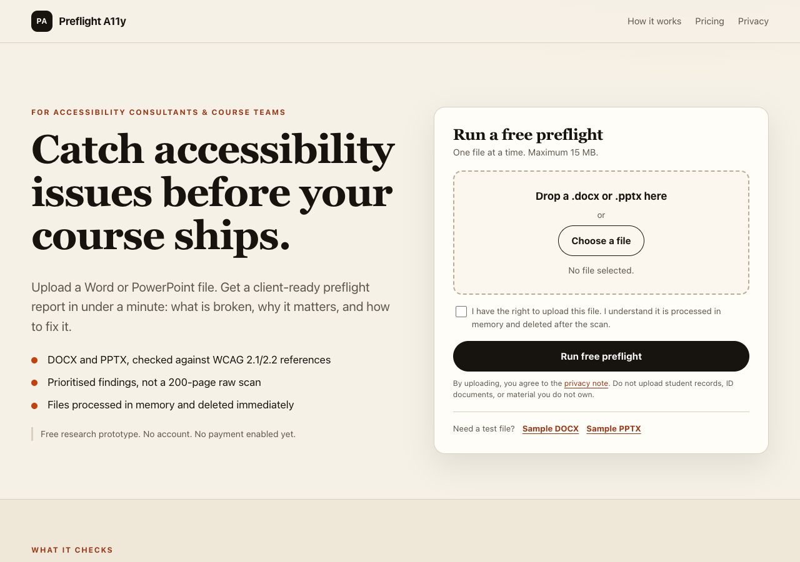

# Preflight A11y

[](https://github.com/huhu954/preflight-a11y/actions/workflows/test.yml)

**Browser-only accessibility preflight for DOCX and PPTX course documents.**

Live: **https://huhu954.github.io/preflight-a11y/**

Upload a Word or PowerPoint file and get a client-ready report: a 0–100 preflight score, findings grouped by severity, WCAG references, plain-English fixes, and a downloadable HTML report. The file is parsed in your browser with JSZip and a rules engine. **It is never uploaded to a server.**



## Guides

- [DOCX accessibility checker: what Microsoft misses](https://huhu954.github.io/preflight-a11y/guides/docx-accessibility-checker.html)
- [PowerPoint accessibility checklist](https://huhu954.github.io/preflight-a11y/guides/powerpoint-accessibility-checklist.html)
- [Section 508 course documents: preflight workflow](https://huhu954.github.io/preflight-a11y/guides/section-508-course-documents.html)
- [Accessibility preflight vs audit: what should you buy?](https://huhu954.github.io/preflight-a11y/guides/accessibility-preflight-vs-audit.html)

## What it checks

- Heading structure and slide titles
- Missing, generic, or duplicated alt text on pictures/charts
- Tables without header rows
- Empty or ambiguous link text
- Text boxes and reading-order risks
- Hidden slides, tiny text, tracked changes/comments
- Embedded audio/video that needs captions

## What it does not do

- It is **not** a compliance certification or legal advice.
- It does not remediate the file.
- It does not cover PDF.
- Automated rules cannot find every WCAG issue; manual review is still required.

## Privacy

- No backend, no upload, no cookies, no analytics, no fingerprinting.
- The report exists only in memory until you download it.
- GitHub Pages may process standard request data to serve the page; see GitHub's privacy statement.

## Develop

```bash
npm install
npm test
npm run build
python3 -m http.server 8877
# open http://127.0.0.1:8877
```

`npm run build` bundles `src/main.js` into `dist/app.js` with esbuild. `dist/app.js` is committed so GitHub Pages needs no build step.

## Tests

```bash
npm test
```

Expected:

```text
ok good.docx score=100 issues=0
ok bad.docx score=63 issues=6
ok good.pptx score=100 issues=0
ok bad.pptx score=69 issues=5
ok error handling
```

## Status

This is a free research preview. Payment is not enabled. No customer, order, or revenue claims are made.

## License

MIT (code). The synthetic sample documents are for testing only.
